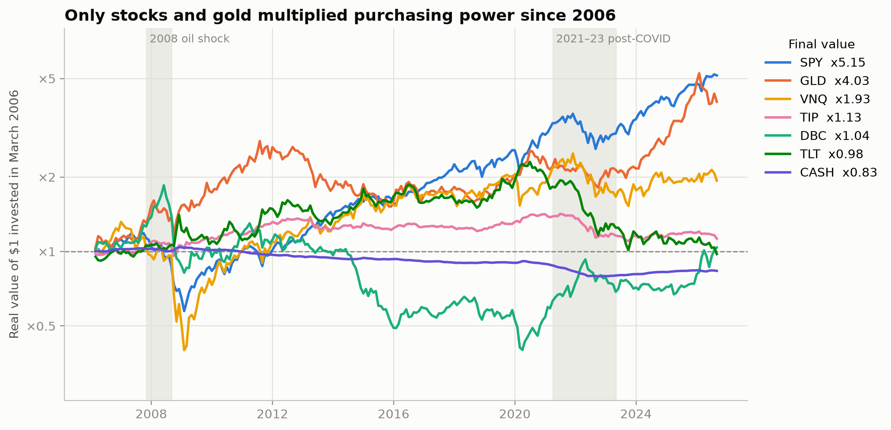
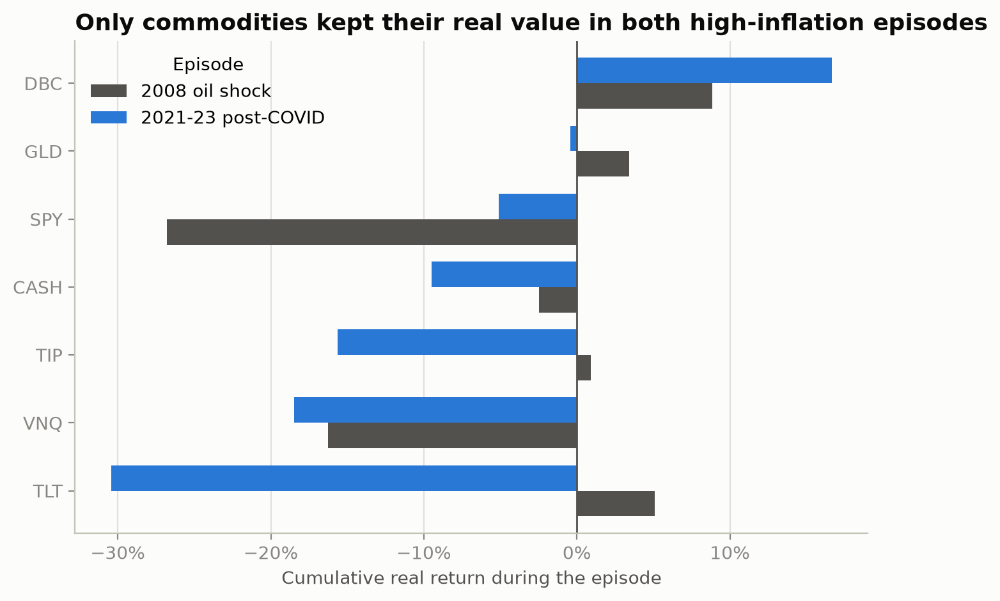
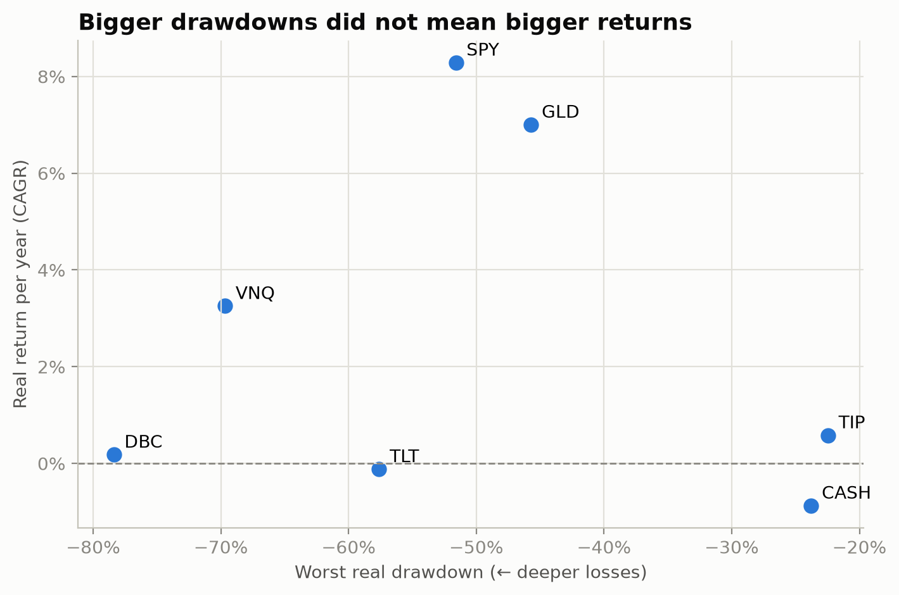
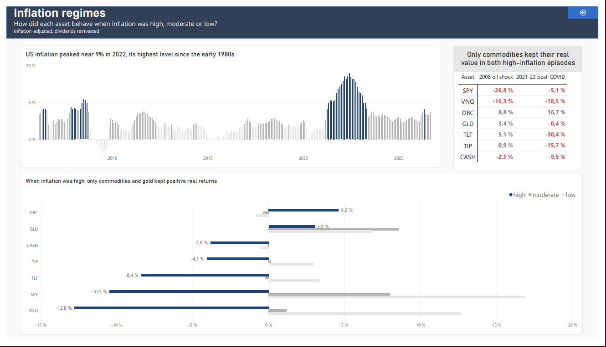

# Inflation Hedge Analysis

Which assets actually protected purchasing power against US inflation over the last two decades?

**TL;DR (March 2006 – September 2026, inflation-adjusted, dividends reinvested)**

- US prices rose **69%**. Cash in Treasury bills **lost 16.5%** of its purchasing power.
- Only **stocks (SPY, +8.3% per year)** and **gold (GLD, +7.0% per year)** multiplied purchasing
  power, both with drawdowns of around 50% along the way.
- In the two high-inflation episodes (2008 and 2021–23), **commodities (DBC) were the only asset
  with positive real returns in both**. Long-term bonds and inflation-linked bonds fell sharply
  in 2021–23 as interest rates rose.



**Tech stack:** Python (requests, pandas, yfinance) · DuckDB + SQL (CTEs, window functions) ·
matplotlib · Power BI (DAX) · ruff

## The question

Over the last ~20 years, which asset classes (stocks, bonds, gold, cash...) delivered positive
**real** returns, and how did they behave during high- vs. low-inflation periods?

## Why it matters

"Buy X to hedge inflation" is common advice, but rarely checked with data.
This project measures real (inflation-adjusted) returns to see which claims hold up.

## Data sources

All data is pulled programmatically via API — no static datasets.

### Inflation

US Consumer Price Index for All Urban Consumers (`CPIAUCSL`, monthly, seasonally adjusted)
from the [FRED API](https://fred.stlouisfed.org/docs/api/fred/) (Federal Reserve Bank of St. Louis).

### Assets

Daily prices from Yahoo Finance via [yfinance](https://github.com/ranaroussi/yfinance).

| Asset class | Ticker | Description |
|---|---|---|
| US equities | SPY | S&P 500 index ETF |
| Real estate | VNQ | US REITs ETF |
| Commodities | DBC | Diversified commodity basket ETF |
| Gold | GLD | Physical gold ETF |
| Long-term bonds | TLT | US Treasury bonds, 20+ years maturity |
| Inflation-linked bonds | TIP | US Treasury Inflation-Protected Securities (TIPS) |
| Cash | TB3MS (FRED) | 3-month US Treasury bill rate |

## Methodology

- **Real return:** `(1 + nominal return) / (1 + monthly inflation) − 1`. Inflation reduces the value
  of all your money, not just the gain, so it is divided out rather than subtracted.
- **Prices:** adjusted close (total return, dividends and coupons reinvested) at the last trading
  day of each month. Price-only returns would understate SPY's growth since 2006 by ~277
  percentage points and would unfairly favour gold, which pays no income.
- **Cash:** 3-month Treasury bill rate (FRED `TB3MS`), converted to a compound monthly return
  using the previous month's rate (the rate known when the month starts).
- **Analysis period:** March 2006 onwards, the first full month with data for all assets
  (DBC started trading in February 2006), up to the last month with published CPI.
- **Inflation regimes:** by year-over-year CPI inflation — low ≤ 2%, moderate 2–4%, high ≥ 4%.
- **High-inflation episodes:** consecutive high-inflation months were grouped with a
  gaps-and-islands query, giving two episodes: **2008 oil shock** (Nov 2007 – Sep 2008) and
  **2021-23 post-COVID** (Apr 2021 – May 2023). Episodes shorter than 3 months are excluded.
- **Missing CPI (October 2025):** not published due to the US government shutdown. Filled with
  the geometric mean of September and November, which preserves the inflation between them,
  and flagged with `cpi_is_imputed`.

## Data pipeline

```
APIs (FRED, Yahoo Finance)
   │  src/ingest.py     → data/raw/                 raw files, exactly as received
   ▼
   │  src/load.py       → data/warehouse.duckdb     staging tables (typed, long format)
   ▼
   │  src/validate.py   → 11 data quality checks; stops the pipeline on errors
   ▼
   │  src/transform.py  → mart tables built from the queries in sql/
   ▼
   │  src/export.py     → data/processed/           CSV files for Power BI
```

`src/pipeline.py` runs all the steps in order with a single command.

Every run reloads all data from scratch. Incremental loading is not used on purpose:
adjusted prices are recalculated backwards after each dividend, and FRED revises
its series, so appending new rows to old ones would mix inconsistent versions.

## Data quality

`src/validate.py` runs 11 automated checks on the staging tables. Each check is a SQL
query that counts problem rows: **errors** stop the pipeline (exit code 1),
**warnings** are reported.

| Table | Check | Severity |
|---|---|---|
| `stg_prices` | `(date, ticker)` is unique | error |
| `stg_prices` | No nulls in `date`, `ticker`, `adj_close` | error |
| `stg_prices` | Prices are positive | error |
| `stg_prices` | All 6 tickers are present | error |
| `stg_prices` | `low <= close <= high` | warning |
| `stg_prices` | No daily move above 25% | warning |
| `stg_prices` | All tickers updated within the last 7 days | warning |
| `stg_fred` | `(date, series_id)` is unique | error |
| `stg_fred` | The only null value is CPI for October 2025 | error |
| `stg_fred` | All dates fall on the first day of the month | error |
| `stg_fred` | No missing months in any series | error |

**Known data issues**
- CPI for October 2025 was not published (US government shutdown). It is stored as
  NULL in staging, and the check above fails if any other null appears.
- DBC started trading on 2006-02-06, so the common analysis period starts in March 2006.
- The largest single-day move in the dataset is −19.5% (VNQ, 2008-12-01), so the 25%
  threshold flags data errors such as unadjusted splits, not genuine market crashes.

## Results

### 1. Long-run real wealth

See the chart at the top of this page.

- **Only stocks and gold multiplied purchasing power.** $1 invested in SPY grew to ×5.15
  in real terms, and in GLD to ×4.03. Real estate (VNQ) roughly doubled (×1.93).
- **Four assets ended near or below their starting purchasing power:** inflation-linked
  bonds (TIP ×1.13) and commodities (DBC ×1.04) barely beat inflation, while long-term
  bonds (TLT ×0.98) and cash (×0.83) lost purchasing power over 20 years.
- **Commodities behave like insurance.** DBC protected purchasing power during the
  high-inflation episodes, but over the whole period it created almost no real wealth:
  the protection came at a high cost the rest of the time.
- **The path matters as much as the destination.** VNQ fell about 70% from its peak by
  early 2009, during the housing and financial crisis, and needed years to recover.

### 2. High-inflation episodes



- **Commodities (DBC) were the only asset with positive real returns in both episodes**
  (+8.8% in 2008 and +16.7% in 2021–23).
- **Gold (GLD) roughly preserved purchasing power** (+3.4% and −0.4%): it neither gained
  nor lost much.
- **Long-term bonds behaved very differently in each episode.** TLT gained +5.1% in 2008 but
  lost −30.4% in 2021–23, consistent with the sharp rise in interest rates in 2022: when rates
  rise, the price of existing long-term bonds falls. Inflation-linked bonds (TIP) also lost −15.7%.
- **Stocks (SPY) and real estate (VNQ) lost in both episodes.** SPY's −26.8% in 2008 overlaps
  with the start of the financial crisis; in 2021–23 its loss was much smaller (−5.1%).
- **Cash lost purchasing power in both episodes** (−2.5% and −9.5%).

### 3. Return vs. risk



- **The best real returns came with large drawdowns.** SPY earned about 8.3% per year in
  real terms and GLD about 7.0%, but at their worst they lost 52% and 46% of their real value.
- **Larger drawdowns were not rewarded with higher returns.** The two assets with the deepest
  drawdowns, DBC (−78%) and VNQ (−70%), delivered only about 0.2% and 3.3% per year.
- **Lower-risk assets barely kept up with inflation.** TIP and cash had the smallest
  drawdowns (about −22% and −24%), but returned about 0.6% and −0.9% per year.
- **Conclusion:** taking more risk did not guarantee more return, and no asset delivered
  strong real returns without deep drawdowns along the way.

## Dashboard

An interactive Power BI dashboard (`dashboard/inflation_hedge.pbix`) lets you explore
the results by asset and period.




## Project structure

```
├── data/
│   ├── raw/                # Data as received from the APIs (generated, not versioned)
│   ├── processed/          # Mart tables exported to CSV for Power BI (generated)
│   └── warehouse.duckdb    # DuckDB database with staging and mart tables (generated)
├── sql/                    # One SQL file per mart table
├── src/
│   ├── ingest.py           # Download raw data from FRED and Yahoo Finance
│   ├── load.py             # Load raw files into typed staging tables
│   ├── validate.py         # Run 11 data quality checks
│   ├── transform.py        # Build mart tables from sql/
│   ├── export.py           # Export mart tables to CSV
│   └── pipeline.py         # Run all steps in order
├── notebooks/              # Exploration and analysis
├── dashboard/              # Power BI report
├── reports/figures/        # Charts used in this README
├── requirements.txt
└── requirements-dev.txt    # Development tools (ruff)
```

## How to run

1. Clone the repository:
   ```
   git clone https://github.com/IgnacioBrunotto/inflation-hedge-analysis.git
   cd inflation-hedge-analysis
   ```
2. Create and activate a virtual environment:
   ```
   python -m venv .venv
   source .venv/Scripts/activate   # Windows (Git Bash)
   source .venv/bin/activate       # macOS / Linux
   ```
3. Install dependencies:
   ```
   python -m pip install -r requirements.txt
   ```
4. Get a free API key at [FRED](https://fred.stlouisfed.org/docs/api/api_key.html),
   copy `.env.example` to `.env` and add your key.
5. Run the full pipeline from the repository root:
   ```
   python src/pipeline.py
   ```
6. Open `notebooks/04_analysis.ipynb` to reproduce the analysis and charts.
7. To open the dashboard, open `dashboard/inflation_hedge.pbix` in Power BI Desktop and point
   the data source to your local `data/processed/` folder
   (*Transform data → Data source settings → Change source*), then refresh.

## Limitations

- **Only two high-inflation episodes.** Conclusions about high inflation rest on 2008 and
  2021–23, and the 2008 episode overlaps with the global financial crisis. They describe what
  happened, not a general rule.
- **Monthly data.** Drawdowns are measured from month-end to month-end, so crashes that recover
  within a month (e.g. March 2020) look smaller than with daily data.
- **ETFs as proxies.** Each asset class is represented by one ETF, including its fees.
- **Thresholds are a choice.** Regime results depend on the 2% and 4% cut-offs.

## Next steps

- **An Argentine saver's perspective:** the same assets measured in pesos and deflated by
  Argentine inflation (requires handling the 2007–2015 CPI data quality issues and multiple
  exchange rates).
- **More episodes:** extend the history to the 1970s with index data to test the conclusions on
  more high-inflation periods.
- **Dashboard:** rebase wealth lines to the start of the selected period.